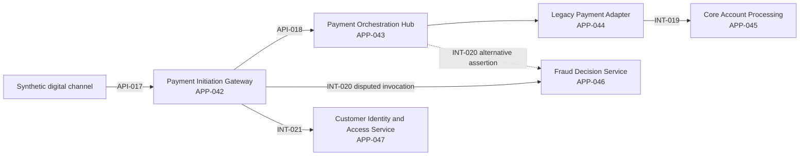

# HSB-SCN-001: customer-payment initiation responsibility

## Document status

**Status:** Initial detailed scenario design under `WRK-012`

**Scenario version:** `HSB-SCN-001/v0.2`

**Pre-registration baseline:** `HSB-SCN-001/v0.1` at Git commit
`f88b0e370a84cdbf38e7d28157b7772997b3ad2c`

**Kernel baseline:** `ADOPTION-KERNEL/v1`

**Scenario execution state:** Designed, not executed

**Architecture stage:** Information Systems Architecture

**Evidence standing:** Synthetic conceptual test design. No scenario result,
BIAN mapping, implementation evidence, real-bank validation or production claim
has been established.

### Change history

| Version | State | Change |
|---|---|---|
| `v0.1` | Committed pre-registration baseline | Initial current-state finding, decision hypothesis and fallback, and controlled-change impact set |
| `v0.2` | Pre-execution refinement | Keeps all three protected `v0.1` byte ranges unchanged; adds mechanical comparison, customer context, mapping lifecycle coverage, the primary-user path, measure executability, a scenario-specific decision-subject rule under `DEC-033`, and a specification-level downstream hand-off |

`tools/check_project.py` compares the exact current-state finding, decision
hypothesis and original impact-set byte ranges with SHA-256 values taken from
the baseline commit. A change to any protected range fails the project check.
The downstream hand-off adds a second impact expectation after the protected
`v0.1` set rather than rewriting it.

## 1. Purpose

This scenario tests whether the proposed BIAN Adoption & Engineering Platform
can help a bank architect make, explain, revisit and act on one contested
architecture decision across fragmented information.

The decision concerns Horizon Synthetic Bank (HSB). HSB is fictional, and every
estate record, participant identity and outcome in this document is
project-authored synthetic content. Payments provides a demanding first
instance, but it does not define the platform's shared information concepts,
logical responsibilities or workflow.

The governing [adoption scenario contract](ADOPTION_SCENARIO_CONTRACT.md)
defines the reusable kernel. This document supplies one scenario instance and
does not redefine that kernel.

## 2. Claim and validation boundary

The scenario is designed to test connected decision value, architectural
coherence and failure visibility. It can later provide conceptual evidence
that the same records support source qualification, estate understanding,
mapping, review, options, decision, downstream outcomes and impact analysis.

Two claims remain separate. The executable structural measures can test
whether the information model carries and reconstructs a connected decision.
The specification-return path can test whether a separately owned response is
caused by connected provenance. Neither result establishes that the connected
path produces greater value or lower effort than the manual alternative. That
comparative claim remains deferred until participants who did not design the
scenario can run the frozen paths.

It cannot establish:

- that any project placeholder represents a BIAN artefact or relationship;
- that the architecture transfers to another banking domain;
- that a real bank has this estate, problem, operating model or demand;
- that a selected option is correct outside the synthetic evidence;
- that an implementation is secure, operable, accessible or production-ready;
- regulatory compliance, external assurance or endorsement; or
- permission to use, transform or redistribute a particular BIAN source.

The separate non-payment transferability probe is required before `GAT-003`
can use `ADOPTION-KERNEL/v1` as domain-transferability evidence.

## 3. Scenario contract record

| Contract field | Scenario value |
|---|---|
| Identity | `HSB-SCN-001/v0.2`; owned by the Architecture owner; pre-execution refinement state |
| Kernel baseline | `ADOPTION-KERNEL/v1`; all `AK-01` through `AK-11` are intended to participate; semantic diff not yet evaluated |
| Primary user | HSB enterprise architect exercising delegated payments-domain authority |
| Trigger | HSB has overlapping payment-related applications and interfaces, unclear responsibility allocation and a proposed modernisation programme |
| Decision | Which HSB assets should own, support or relinquish the bounded customer-payment initiation responsibility, and in what transition sequence? |
| Intended outcome | A reconstructable target-allocation and transition decision, owned actions and explicit unresolved matters |
| Existing alternative | Spreadsheet inventory, architecture-repository diagrams, catalogue searches, meetings and a decision paper assembled manually |
| Scope | The synthetic estate, sources, participants and time boundary in sections 4 through 7 |
| BIAN context | `SUBJ-PRJ-BIAN-SCOPE-001`, a Class C project placeholder; exact BIAN scope and relationships unresolved; BIAN attribution blocked |
| Source shape | HSB application, API, integration, architecture, ownership and control sources participate; BIAN API-publication state is unresolved because exact BIAN scope is absent |
| Customer context | Horizon Synthetic Bank only; the synthetic estate, participants, sources, contradictions, classifications and limitations are defined in sections 5 through 8 |
| Decision subject | `SUBJ-HSB-RESP-001`, an HSB scenario-specific subject; it is not an adoption-kernel concept and is not required in the transferability probe |
| Decision rights | Defined in section 5; information stewardship, review, target decision, control conclusion and funding are separate rights |
| Maintained scope | Identified records and relationships from baseline time `T0` until scenario change `T1`; additions require a recorded scope decision |
| Options | Current-state continuation, consolidation into an existing HSB application, and creation of a new HSB responsibility holder |
| Expected outcome | Pre-registered decision hypothesis and decision rule in section 10; actual result is unevaluated |
| Trust paths | `TB-01` through `TB-08` and `TB-11` participate; `TB-09` is exercised by a synthetic profile attachment; `TB-10` is non-participating and retained as a limitation |
| Measures | Executable source, conflict, mapping, reconstruction, ownership, impact and connected-return measures; time, independent review and repeated-stewardship measures are explicitly deferred |
| Change | `HSB-CHG-001` changes an accepted estate foundation at `T1` and requires downstream impact review |
| View provenance | `VIEWDEF-HSB-SCN-001@1` and its planned baseline and decision materialisations |
| Export boundary | `HSB-EXPORT-SCN-001@1`, containing the portable HSB decision package without rights-restricted source content |
| Claim boundary | Synthetic conceptual evidence only, subject to the exclusions above |

### Time boundary

| Symbol | Synthetic time | Use |
|---|---|---|
| `T0` | `2026-08-18T10:00:00Z` | Baseline estate and decision-view evaluation time |
| `T1` | `2026-09-15T10:00:00Z` | Controlled-change and impact-view evaluation time |

These times make the scenario reproducible. They do not represent actual bank
events or completed project work.

## 4. Bounded decision and hard constraints

### Decision question

> Which HSB assets should own, support or relinquish the bounded
> customer-payment initiation responsibility in the target state, and how
> should HSB sequence the transition without hiding existing dependencies,
> control obligations or uncertainty?

The scenario uses `SUBJ-HSB-RESP-001` as an HSB scenario-specific responsibility
subject under `DEC-033`. Its registration is useful for this decision shape,
but it is not an adoption-kernel concept or a mandatory structure for another
scenario. It does not assert that this responsibility is a BIAN Service Domain,
Business Capability, Business Scenario, Control Record or Service Operation.

Any option selected by the HSB Architecture owner must satisfy these synthetic
hard constraints:

1. one accountable target responsibility holder is named;
2. channel-specific interaction and core-account posting remain explicitly
   allocated rather than absorbed into an ambiguous label;
3. identity, fraud and posting dependencies remain visible;
4. no unverified candidate relationship is presented as BIAN truth;
5. the selected transition has owners, sequencing, coexistence rules and a
   recoverable decision history;
6. unresolved ownership or sensitivity blocks approval or export for the
   affected records; and
7. the decision does not authorise implementation or funding by implication.

Failure of any hard constraint leaves the decision unresolved. An ordinal
option comparison cannot override that result.

## 5. HSB organisation and decision rights

The roles below are scenario roles mapped to the repository's canonical
accountabilities. One project participant may simulate several roles, but each
action must record which delegated right was exercised. Self-review is an
evidence limitation, not independent challenge.

| Scenario participant | Canonical accountability | Decision right in this scenario | Explicit limit |
|---|---|---|---|
| HSB enterprise architect | Architecture owner | Propose mappings and options; approve the target allocation within the recorded HSB mandate | Cannot create BIAN truth, approve source rights or accept a control conclusion |
| HSB bank information steward | Bank information steward | Confirm source identity, ownership, sensitivity, correction and HSB assertion state | Cannot choose the target architecture solely through source precedence |
| Payments Platform asset owner | Application, API, or service owner | Review assertions and accept actions for the Payment Initiation Gateway and Payment Orchestration Hub | Cannot approve actions for another owner's asset |
| Digital Channels asset owner | Application, API, or service owner | Review channel and Payment Initiation API assertions and actions | API support ownership is not target-architecture authority |
| Core Banking Integration asset owner | Application, API, or service owner | Review Legacy Payment Adapter assertions and transition actions | Cannot determine the bank-wide responsibility allocation |
| Core Banking asset owner | Application, API, or service owner | Review posting dependency, coexistence and change risk | Cannot silently broaden the decision into core-account replacement |
| Financial Crime and Digital Identity owners | Application, API, or service owner | Review fraud and identity dependency assertions and owned actions | Supporting dependency does not imply ownership of payment initiation |
| BIAN source steward | BIAN source steward | Qualify exact source and release identity when an authorised source is available | Cannot infer the missing BIAN scope or approve HSB architecture |
| Source-rights reviewer | Source-rights reviewer | Permit or block the intended source uses for the exact source and release | Cannot change BIAN meaning or HSB target allocation |
| HSB security owner | Security owner | Approve the project-defined HSB security profile and decide scoped security risk | Cannot issue regulatory or broad compliance conclusions |
| HSB assurance owner | Assurance owner | Decide evidence sufficiency for the stated control scope | Cannot approve the target architecture or turn an unverified area into evidence |
| HSB Engineering owner | Engineering owner | Own the specification-hand-off response and accept, return or reject readiness for later bounded Solution Architecture | Cannot approve the HSB target decision, authorise implementation or close an evidence gap by accepting the hand-off |
| HSB transformation sponsor | Product owner for the synthetic programme | Decide whether to fund and sequence actions after the architecture decision | Funding does not create semantic or architecture authority |
| Independent scenario reviewer | Independent reviewer | Challenge reconstruction, reasoning, limitations and domain leakage | Cannot be simulated by the scenario author and described as independent evidence |

### Objection and escalation path

An asset owner may dispute an assertion, mapping, impact or assigned action.
The disputed record remains visible and cannot be treated as accepted. The HSB
enterprise architect first narrows or resolves the architecture question with
the affected owner. Unresolved cross-owner allocation is escalated to the HSB
Chief Architect acting as the recorded Architecture owner. Source identity and
rights disputes remain with their respective stewards and cannot be overruled
by the architecture escalation.

## 6. Synthetic estate baseline

The first two subjects reuse the record-level example in
[Phase C model validation](PHASE_C_MODEL_VALIDATION.md). The remaining subjects
extend that HSB namespace for this scenario. Registering them creates stable
identity anchors only; their properties remain attributable Class D HSB
assertions.

| Subject ID | Synthetic asset | Current responsibility in the scenario | Accountable HSB owner | Lifecycle assertion at `T0` |
|---|---|---|---|---|
| `SUBJ-HSB-APP-042` | Payment Initiation Gateway | Receives channel requests, applies channel validation and translates request shape | Payments Platform asset owner, disputed by Digital Channels source | Maintain |
| `SUBJ-HSB-APP-043` | Payment Orchestration Hub | Coordinates instruction state, idempotency and routing | Payments Platform asset owner | Strategic |
| `SUBJ-HSB-APP-044` | Legacy Payment Adapter | Translates and submits instructions to core processing; retains duplicate validation | Core Banking Integration asset owner | Contain |
| `SUBJ-HSB-APP-045` | Core Account Processing | Maintains account state and performs posting | Core Banking asset owner | Maintain |
| `SUBJ-HSB-APP-046` | Fraud Decision Service | Supplies a fraud assessment used before instruction acceptance | Financial Crime asset owner | Strategic |
| `SUBJ-HSB-APP-047` | Customer Identity and Access Service | Supplies customer authentication and channel identity context | Digital Identity asset owner | Strategic |

### Interfaces and interactions

| Subject ID | Synthetic interface | Provider | Consumer or interaction | Scenario standing |
|---|---|---|---|---|
| `SUBJ-HSB-API-017` | Payment Initiation API | Payment Initiation Gateway | Digital channels | Existing Phase C subject; HSB API, not a BIAN API |
| `SUBJ-HSB-API-018` | Payment Instruction API | Payment Orchestration Hub | Payment Initiation Gateway | HSB catalogue assertion |
| `SUBJ-HSB-INT-019` | Legacy Posting Interface | Core Account Processing | Legacy Payment Adapter | HSB integration assertion; not assumed to be an API |
| `SUBJ-HSB-INT-020` | Fraud Assessment Interaction | Fraud Decision Service | Payment Initiation Gateway and Payment Orchestration Hub | Provider and invocation point are disputed |
| `SUBJ-HSB-INT-021` | Customer Authentication Interaction | Customer Identity and Access Service | Payment Initiation Gateway | HSB integration assertion |

This diagram is an HSB current-state hypothesis. It is not a platform component
view, a BIAN wireframe or a prescribed target implementation.

## 7. Source set, assertions and contradictions

### Source captures

| Capture ID | Synthetic source | Scope supplied | Authority and limitation |
|---|---|---|---|
| `SC-HSB-CMDB-20260818-001` | Horizon CMDB | Payment Initiation Gateway and source owner | Existing Class D capture; owner field may describe operational support |
| `SC-HSB-API-20260818-001` | Horizon API Catalogue | Payment Initiation API and API owner | Existing Class D capture; API ownership is not application accountability |
| `SC-HSB-CMDB-20260818-002` | Horizon CMDB estate snapshot | Applications `043` through `047`, lifecycle and support owner | Synthetic snapshot; dependencies are incomplete |
| `SC-HSB-API-20260818-003` | Horizon API Catalogue snapshot | API `018` and interface metadata | Synthetic snapshot; integration `019` is absent |
| `SC-HSB-INT-20260818-001` | Horizon Integration Catalogue | Interactions `019` through `021` and provider-consumer assertions | Synthetic snapshot; invocation detail conflicts with architecture repository |
| `SC-HSB-EA-20260818-001` | Horizon Architecture Repository | Current responsibility and target-principle assertions | Synthetic architecture opinion; approval state is unclear |
| `SC-HSB-OWN-20260818-001` | Horizon Ownership Register | Named asset and action owners | Synthetic governance source; one Gateway owner conflicts with CMDB |
| `SC-HSB-CTL-20260818-001` | Horizon Control Catalogue | HSB project-defined security control expectations | Project-defined profile input, not regulation or external assurance |

Every capture is `HSB-INTERNAL-SYNTHETIC`. Reviewer identities are fictional
personal information and remain subject to the privacy position in the trust
architecture. Missing classification is retained as `Unclassified`, handled as
restricted and routed for review.

### Deliberate contradictions and gaps

| Conflict ID | Competing assertions | Required scenario behaviour |
|---|---|---|
| `HSB-CON-001` | CMDB assigns Gateway support to Payments Platform; Ownership Register assigns the Digital Channels owner | Preserve both, distinguish support from accountability and require steward review; no silent winner |
| `HSB-CON-002` | Architecture Repository says Gateway currently holds the bounded responsibility; orchestration records imply the Hub holds its state and decision flow | Represent both relationship assertions as disputed until the Architecture owner records the bounded interpretation |
| `HSB-CON-003` | Integration Catalogue places fraud assessment before the Hub; Architecture Repository places it within orchestration | Show both dependency paths and their option impact; do not alter either source record |
| `HSB-CON-004` | CMDB marks the Hub Strategic while the later controlled change marks it Replace | Preserve both temporal assertions and put dependant target records into impact review at `T1` |
| `HSB-GAP-001` | Exact BIAN artefact, release-qualified relationship and source-rights decision are absent | Keep `SUBJ-PRJ-BIAN-SCOPE-001`; block Class A assertion and accepted BIAN mapping |
| `HSB-GAP-002` | No source establishes whether the Legacy Payment Adapter's duplicate validation is required by policy | Record the uncertainty; do not treat removal as safe without an owner action |
| `HSB-GAP-003` | No production workload, resilience or failure-rate evidence exists | Limit option conclusions; do not make capacity, service-level or production-readiness claims |

## 8. Maintained relationship set

The scenario maintains the following relationship assertions because they can
change the decision or its consequences. Their identifiers represent scenario
records, not accepted truth.

| Relationship ID | Left subject | Relationship | Right subject | Class | Initial state |
|---|---|---|---|---|---|
| `REL-HSB-002` | `SUBJ-HSB-APP-042` | `currently_holds` | `SUBJ-HSB-RESP-001` | D | Disputed, reused from Phase C validation |
| `REL-HSB-SCN-001` | `SUBJ-HSB-APP-043` | `currently_holds_part_of` | `SUBJ-HSB-RESP-001` | D | Proposed |
| `REL-HSB-SCN-002` | `SUBJ-HSB-APP-044` | `currently_holds_part_of` | `SUBJ-HSB-RESP-001` | D | Proposed |
| `REL-HSB-SCN-003` | `SUBJ-HSB-APP-042` | `depends_on` | `SUBJ-HSB-APP-047` | D | Proposed |
| `REL-HSB-SCN-004` | `SUBJ-HSB-APP-042` | `depends_on` | `SUBJ-HSB-APP-046` | D | Disputed |
| `REL-HSB-SCN-005` | `SUBJ-HSB-APP-043` | `depends_on` | `SUBJ-HSB-APP-046` | D | Disputed |
| `REL-HSB-SCN-006` | `SUBJ-HSB-APP-044` | `depends_on` | `SUBJ-HSB-APP-045` | D | Proposed |
| `REL-HSB-SCN-007` | `SUBJ-HSB-APP-042` | `candidate_mapping_to` | `SUBJ-PRJ-MAP-TARGET-001` | E | Proposed at `AK-04` |
| `REL-HSB-SCN-008` | `SUBJ-HSB-APP-043` | `candidate_mapping_to` | `SUBJ-PRJ-MAP-TARGET-001` | E | Proposed at `AK-04` |
| `REL-HSB-SCN-009` | `SUBJ-HSB-APP-043` | `candidate_mapping_to` | `SUBJ-PRJ-MAP-TARGET-002` | E | Proposed at `AK-04` |
| `REL-HSB-SCN-010` | `SUBJ-HSB-APP-043` | `candidate_mapping_to` | `SUBJ-PRJ-MAP-TARGET-003` | E | Proposed at `AK-04` |
| `REL-HSB-SCN-011` | `SUBJ-HSB-APP-044` | `candidate_mapping_to` | `SUBJ-PRJ-MAP-TARGET-001` | E | Proposed at `AK-04` |
| `REL-HSB-SCN-012` | `SUBJ-HSB-APP-045` | `candidate_mapping_to` | `SUBJ-PRJ-MAP-TARGET-004` | E | Proposed at `AK-04` |

### Structurally neutral mapping targets

| Subject ID | Label | Standing |
|---|---|---|
| `SUBJ-PRJ-MAP-TARGET-001` | Unresolved candidate target A | Class C project placeholder with no asserted BIAN identity, type, hierarchy or meaning |
| `SUBJ-PRJ-MAP-TARGET-002` | Unresolved candidate target B | Class C project placeholder with no asserted BIAN identity, type, hierarchy or meaning |
| `SUBJ-PRJ-MAP-TARGET-003` | Unresolved candidate target C | Class C project placeholder with no asserted BIAN identity, type, hierarchy or meaning |
| `SUBJ-PRJ-MAP-TARGET-004` | Unresolved candidate target D | Class C project placeholder with no asserted BIAN identity, type, hierarchy or meaning |

The placeholders exist only to test relationship cardinality and lifecycle.
Their distinct identities do not assert that BIAN contains three corresponding
elements or that any relationship exists among them. Every candidate mapping
remains blocked from BIAN attribution until exact source qualification replaces
or rejects the placeholder.

### Mapping lifecycle test

Shape and review state are separate. Every relationship is first proposed at
`AK-04`; rejection and supersession can occur only after evidence and conflict
analysis at `AK-05` and accountable review at `AK-06`.

| Test | Relationship records | Shape at `AK-04` | `AK-05` evidence or contest | Pre-registered `AK-06` outcome |
|---|---|---|---|---|
| `HSB-MAP-001` | `REL-HSB-SCN-007` and `011` | Gateway and Legacy Adapter to target A as a many-to-one candidate | Responsibility boundaries overlap; channel interaction is insufficient evidence and exact target meaning is absent | Reject `007`; keep `011` disputed and blocked; retain both histories |
| `HSB-MAP-002` | `REL-HSB-SCN-008` through `010` | Hub to targets A, B and C as a one-to-many candidate | One source asset appears to span several unresolved target candidates | Supersede `008` with `009` and `010` only as an HSB review outcome; all remain blocked from BIAN attribution |
| `HSB-MAP-003` | `REL-HSB-SCN-012` | Core Account Processing to target D as a one-to-one candidate | Exact target meaning and source support are absent | Retain as contested and blocked rather than convert structural uniqueness into confidence |
| `HSB-MAP-004` | `SUBJ-HSB-APP-046` | Explicitly unmapped; no relationship is created | No source-qualified target candidate exists for the supporting dependency | Confirm unmapped state without inventing a target |

These transitions test that proposed, disputed, rejected, superseded and
unmapped states remain representable. They do not test whether a BIAN mapping
is correct. The execution record must retain the `AK-04` proposals and `AK-05`
evidence when the `AK-06` outcome changes their review state.

## 9. Current-state finding

The pre-registered current-state finding is:

> HSB's bounded customer-payment initiation responsibility is distributed
> across the Gateway, Hub and Legacy Adapter without one accepted allocation
> record. Source systems disagree about ownership and the fraud invocation
> point. The decision cannot safely rely on a BIAN relationship, production
> workload evidence or policy justification for duplicate validation because
> those foundations are absent.

This is a Class E platform inference until reviewed. Execution must test it
against the exact source records and contrary evidence. A reviewer may accept,
revise, reject or leave the finding unresolved without changing the underlying
source assertions.

## 10. Options and pre-registered decision hypothesis

### Option set

| Option | Target allocation | Transition outline | Principal benefit hypothesis | Principal cost or risk |
|---|---|---|---|---|
| `HSB-OPT-001` Continue the distributed allocation | Gateway, Hub and Legacy Adapter retain current parts with an explicit responsibility and interaction contract | Clarify owners and controls without moving responsibility | Lowest structural change and most reversible | Existing duplication and cross-owner ambiguity may remain expensive |
| `HSB-OPT-002` Consolidate bounded coordination in the Hub | Hub becomes accountable holder; Gateway retains channel interaction; Legacy Adapter retains only required core translation; identity, fraud and posting stay explicit dependencies | Resolve ownership first, move orchestration and duplicate rules in controlled increments, then reassess the Legacy Adapter | Uses an existing strategic HSB asset and may reduce duplicate coordination | Hub concentration, coexistence complexity and missing workload evidence can invalidate the option |
| `HSB-OPT-003` Introduce a new responsibility holder | A new HSB application becomes accountable holder; existing assets become adapters or dependencies | Define the new boundary, establish coexistence, migrate consumers, then retire duplicated paths | Clean target boundary without inheriting current ownership dispute | Adds another asset, migration path and operating burden before demand and capacity are evidenced |

### Evaluation method

Each option first passes or fails the hard constraints in section 4. Options
that pass are compared using attributable, ordinal findings rather than a
fabricated numerical score:

- clarity of accountable responsibility and owned action;
- cohesion of the bounded responsibility and visibility of retained
  dependencies;
- source and evidence sufficiency;
- security, privacy and assurance consequences;
- coexistence, reversibility and transition complexity;
- resilience and workload uncertainty;
- effect on duplicated logic and interfaces; and
- ability to identify downstream change impact.

Each conclusion must state supporting records, contrary records, reviewer,
limitations and whether its result is `supported`, `contested`, `insufficient`
or `not assessed`.

### Expected outcome recorded before execution

`HSB-OPT-002` is the decision hypothesis only if it passes every hard
constraint and evidence supports the Hub's strategic lifecycle, responsibility
cohesion and manageable coexistence. `HSB-OPT-001` is the fallback if ownership
can be made explicit but consolidation lacks evidence. `HSB-OPT-003` is expected
to be rejected unless the existing assets cannot hold the bounded
responsibility and a new operating burden is justified.

If source qualification, owner review or required evidence is absent, the
expected outcome is an unresolved decision with owned evidence actions, not a
forced selection. The eventual HSB decision record is
`HSB-ARC-DEC-001`; it does not yet exist as an accepted outcome.

## 11. Kernel-stage execution design

All stages participate in the deep scenario. The table maps scenario work to
the canonical stages and behaviours without creating a second kernel.

| Stage | Scenario work and governed records | Canonical behaviours | Design state |
|---|---|---|---|
| `AK-01` | Record the bounded question, trigger, mandate, existing alternative, intended outcome and stop conditions in `HSB-SCN-001/v0.2` | `KB-05`, `KB-09` | Designed; not executed |
| `AK-02` | Qualify the exact BIAN source or retain `SUBJ-PRJ-BIAN-SCOPE-001` and block BIAN attribution | `KB-01`, `KB-09` | Designed; source unresolved |
| `AK-03` | Capture and validate the HSB source set, subjects, assertions, sensitivity, owners and limits | `KB-01`, `KB-02`, `KB-09` | Designed; not executed |
| `AK-04` | Propose responsibility, dependency and candidate-scope relationships, including the initial states in `HSB-MAP-001` through `004` | `KB-02`, `KB-03`, `KB-09` | Designed; not executed |
| `AK-05` | Evaluate evidence, gaps, `HSB-CON-001` through `004` and mapping contests while retaining contrary assertions | `KB-03`, `KB-04`, `KB-09` | Designed; not executed |
| `AK-06` | Exercise source, asset, security, assurance and architecture review rights, including mapping rejection, supersession, objection and escalation | `KB-04`, `KB-05`, `KB-09` | Designed; not executed |
| `AK-07` | Review the Class E current-state finding in section 9 | `KB-04`, `KB-09` | Designed; not executed |
| `AK-08` | Compare `HSB-OPT-001` through `HSB-OPT-003`, including transition and no-change | `KB-04`, `KB-06`, `KB-09` | Designed; not executed |
| `AK-09` | Record `HSB-ARC-DEC-001`, rejected alternatives, rationale, uncertainty, owners and actions | `KB-05`, `KB-06`, `KB-09` | Designed; no accepted decision |
| `AK-10` | Produce the decision view, specification hand-off, project-defined assurance path and `HSB-EXPORT-SCN-001@1`; record the hand-off return and any external reconciliation result | `KB-07`, `KB-09` | Designed; not executed |
| `AK-11` | Apply `HSB-CHG-001`, identify every maintained dependant and preserve the `T0` view | `KB-08`, `KB-09` | Designed; not executed |

**Kernel semantic diff state:** Not evaluated. An empty semantic diff may be
recorded only after scenario execution confirms that no shared semantic or
logical-behaviour change was required.

### Primary-user action path

This is an experience-neutral walkthrough, not a user-interface or application
design. It makes the platform-assisted path concrete enough to compare with the
manual alternative.

| Stage | What the HSB enterprise architect does | Observable result |
|---|---|---|
| `AK-01` | States the decision, mandate, maintained scope, intended outcome and stop conditions | A bounded scenario record that another participant can challenge |
| `AK-02` | Selects a qualified BIAN source context or explicitly records that exact scope and rights are unresolved | BIAN use proceeds with qualified provenance or stops behind the project placeholder |
| `AK-03` | Supplies or references the six HSB source families, reviews validation results and assigns missing classification or ownership for resolution | Source captures and HSB assertions are available without replacing their systems of record |
| `AK-04` | Reviews registered estate identities and proposes responsibility, dependency and candidate mapping relationships | Attributable proposals exist, including mixed cardinality and an explicit unmapped state |
| `AK-05` | Examines supporting and contrary evidence, the four planted conflicts and the three evidence gaps | Conflicts remain visible and each finding records sufficiency and limitations |
| `AK-06` | Requests bounded review from stewards and asset owners, responds to objections and routes unresolved allocation to the recorded decision authority | Rejected, disputed, superseded and accepted states retain the actors and rationale that produced them |
| `AK-07` | Reviews the pre-registered current-state finding against the exact evidence and records acceptance, revision, rejection or unresolved status | The finding cannot become HSB truth by inference alone |
| `AK-08` | Applies the hard constraints and compares all three options without using a numerical score to override a failed gate | A traceable option comparison, including no change |
| `AK-09` | Records the selected or unresolved outcome, rejected alternatives, rationale, owners, actions and limits | `HSB-ARC-DEC-001` is created only if the delegated decision is exercised |
| `AK-10` | Sends the specification hand-off to the Engineering owner, receives its return or acceptance, and produces the scoped decision, assurance and export outcomes | A separately owned response can change an action; outputs retain provenance and restrictions |
| `AK-11` | Introduces `HSB-CHG-001`, reviews both expected impact sets and routes affected records to their owners | The earlier decision remains reconstructable while current records show impact review |

## 12. Scenario-specific View Definition

`VIEWDEF-HSB-SCN-001@1` is a Class C project extension owned by the Information
model steward. It is concrete scenario configuration, not part of the adoption
kernel.

| Rule | Definition |
|---|---|
| Purpose | Present the maintained records required to reconstruct the HSB allocation decision and its later impact review |
| Required parameters | Effective time, recorded time, scenario version, kernel version and ownership scope |
| Selection | Include only maintained-scope records effective at the requested time and recorded no later than the requested recorded time |
| Conflict behaviour | Retain competing assertions; select no winner without a linked authorised decision for the exact conflict |
| Absence behaviour | Display unresolved, unsupported, Unclassified and not-assessed states rather than omit them |
| Point-of-use context | Carry truth class, source or method, review state, effective and recorded time, sensitivity, limitations and BIAN release where BIAN-attributed |
| Inference behaviour | Keep option findings and recommendations Class E even when deterministic evaluation is used |
| Historical behaviour | Preserve record identifiers and lineage for withdrawn or superseded inputs and reproduce the exact earlier materialisation |
| Output restriction | Replace rights-restricted external content with its permitted identifier, release and source reference |

The planned materialisations are:

- `PROJ-HSB-SCN-001-T0`, the baseline and decision input view evaluated at
  `T0`; and
- `PROJ-HSB-SCN-001-T1`, the impact-review view evaluated at `T1` after
  `HSB-CHG-001`.

Each materialisation must identify the exact input records and versions,
evaluation context, `VIEWDEF-HSB-SCN-001@1`, transformation version, result
identity or digest and limitations. Neither materialisation has been produced.

## 13. Trust-boundary and negative-path design

The normal scenario path crosses `TB-01` through `TB-08` and `TB-11`.
`TB-09` participates through one project-defined HSB security-profile
attachment. `TB-10` does not participate because this conceptual scenario does
not admit a contribution or release; its absence is explicit and does not
weaken the later open-source release gate.

| Test ID | Boundary or threat | Synthetic input or attempted action | Expected non-success outcome | Required conceptual evidence |
|---|---|---|---|---|
| `HSB-NEG-001` | `TB-01`, `THR-01` | Modified file labelled as authorised BIAN content | Quarantine; no Class A assertion or accepted BIAN mapping | Capture, failed source decision and visible unresolved BIAN scope |
| `HSB-NEG-002` | `TB-02`, `THR-03` | HSB record without owner or sensitivity | Retain Unclassified, handle as restricted and block affected export | Absence state, denial and steward action |
| `HSB-NEG-003` | `TB-01`, `THR-15` | Oversized or malformed synthetic source | Stop within declared bounds and promote no records | Limit, failure state, resource outcome and quarantine identity |
| `HSB-NEG-004` | `TB-03` to `TB-05`, `THR-06` | Conflicting Gateway owners | Preserve both assertions and leave unresolved until authorised decision | Conflict view, provenance and decision state |
| `HSB-NEG-005` | `TB-01`, `TB-03`, `THR-02` | Instruction-like source description | Treat as data; invoke no tool and change no policy or truth class | Bounded method input and analysis limitation |
| `HSB-NEG-006` | `TB-04`, `TB-06`, `THR-04` | Candidate mapping rendered without Class E label | Fail view or export verification | Missing-context finding and rejected output identity |
| `HSB-NEG-007` | `TB-05`, `TB-11`, `THR-05` | Digital Channels owner attempts the target-allocation approval | Deny action and leave governed state unchanged | Actor, delegated scope, attempted action and denial |
| `HSB-NEG-008` | `TB-06`, `TB-09`, `THR-07` | Projection or profile attempts to alter source assertions or owned artefacts | Reject change outside its isolated output namespace | Input-output boundary and verification result |
| `HSB-NEG-009` | `TB-03` to `TB-08`, `THR-10` | Evidence expires or a maintained source is withdrawn | Put every dependant into impact review and retain prior history | Impact set, affected owners, current limit and `T0` view |
| `HSB-NEG-010` | `TB-11`, `THR-05` | Participant with a second synthetic ownership scope requests HSB records | Deny without confirming protected-record existence | Non-disclosing policy decision and denial evidence |

These are expected outcomes at the conceptual level. They are not security-test
results and cannot close implementation or operational evidence gaps.

## 14. Controlled change and downstream impact

`HSB-CHG-001` introduces at `T1` a corrected, steward-reviewed HSB lifecycle
assertion changing the Payment Orchestration Hub from `Strategic` to `Replace`
because a fictional vendor support decision invalidates the earlier roadmap
assumption. The change is deliberately severe because `HSB-OPT-002` depends on
the Hub remaining a credible target responsibility holder.

The earlier Class D assertion remains in history. The corrected assertion does
not rewrite `T0` or silently select a different option.

The expected impact-review set is:

| Impacted record or concern | Expected state at `T1` | Accountable action |
|---|---|---|
| Hub lifecycle assertion | Superseded, with both effective and recorded times retained | Bank information steward validates correction provenance |
| `REL-HSB-SCN-001`, `005` and `008` | Impact review | Relevant asset owners review responsibility, fraud and candidate-scope relationships |
| `HSB-OPT-002` findings | Impact review | Architecture owner reassesses hard constraints and option comparison |
| `HSB-ARC-DEC-001`, if accepted at `T0` | Impact review, not silently withdrawn | Architecture owner confirms, supersedes or reopens the decision |
| Target and transition actions | Suspended where they depend on the Hub's target standing | Transformation sponsor and action owners resequence or stop work |
| HSB security-profile conclusion | Impact review only for controls whose scope depends on the Hub target | Security and Assurance owners record the bounded result |
| `PROJ-HSB-SCN-001-T0` | Historical and reconstructable | Information model steward verifies unchanged reconstruction |
| `PROJ-HSB-SCN-001-T1` | New governed materialisation | Information model steward records changed inputs and limitations |
| `HSB-EXPORT-SCN-001@1` | Stale until regenerated and reconciled | Architecture owner blocks presentation as current |

Execution passes this change test only when every maintained dependant is
either in the impact set or has an attributable exclusion rationale. Finding a
miss is useful failure evidence and must not be hidden by narrowing the scope
after the result.

### `v0.2` additive downstream impact expectation

The `v0.1` table above remains the protected original impact set. The
specification hand-off introduced in `v0.2` creates two new dependant records
that did not exist at baseline. They extend the execution test without changing
the original expectation.

| Added record or concern | Expected state at `T1` | Accountable action |
|---|---|---|
| `HSB-HO-ENG-001@1` | Impact review because its proposed target depends on the Hub's earlier lifecycle assertion | Engineering owner returns, confirms or supersedes the hand-off response within the changed evidence scope |
| `HSB-HO-RET-001` | Impact review because the reason for return may change when the target option is no longer credible | Architecture owner retains the original return and determines whether a new hand-off is justified |

Execution reports two results: completeness against the byte-protected `v0.1`
impact set, and completeness against the expanded `v0.1` plus `v0.2` set. A
pass against the expanded set cannot conceal a miss from the original set.

## 15. Downstream outcomes and portable decision package

### Participating outcomes

The scenario uses one separately owned specification hand-off and three
decision projections to test whether connected provenance changes an owned
response:

1. `HSB-HO-ENG-001@1`, a specification-level engineering hand-off with its own
   owner, response and lifecycle;
2. an architecture decision view containing the selected or unresolved option,
   contrary evidence and owned transition actions;
3. a project-defined HSB assurance path that distinguishes verified, failed,
   expired, partial and unverified control conclusions for the exact scenario
   scope; and
4. a customer-owned export package for independent reconstruction and exit.

No service scaffold, SDK, deployment artefact or implementation change is
created or authorised. The hand-off specifies the target responsibility,
interface ownership, evidence, limitations and questions that a future bounded
Solution Architecture would need to address. It does not select a solution or
request implementation.

### Specification hand-off and pre-registered return

| Field | Scenario definition |
|---|---|
| Record | `HSB-HO-ENG-001@1` |
| Sender | Architecture owner after `AK-09` |
| Receiver and owner | Engineering owner |
| Content | Selected or unresolved target allocation, affected HSB interfaces, accepted and rejected relationships, exact provenance, hard-constraint result, evidence gaps and prohibited claims |
| Lifecycle | Draft, offered, returned, reworked, accepted for bounded Solution Architecture, rejected, impact review or superseded |
| Expected `AK-10` response | Returned as `HSB-HO-RET-001` because `HSB-GAP-003` supplies no production workload, resilience or failure-rate evidence for the proposed Hub target |
| Effect of return | Target implementation and solution selection remain unauthorised; the Architecture owner must retain the limitation and assign evidence work rather than remove it from the hand-off |
| Surprising result | Acceptance is permitted only if execution identifies attributable evidence that closes `HSB-GAP-003`; the result and deviation from the pre-registration must be recorded |

The expected return is the connected-value test. A successful delivery action
is not assumed to be evidence of value. The test asks whether the receiving
owner can reject an apparently preferred path because the connected provenance
exposes an exact insufficiency that a disconnected summary could hide.

### Export package

`HSB-EXPORT-SCN-001@1` is the planned portable semantic set under `DAR-016`.
It includes:

- the HSB-supplied source records and retained source references in scope;
- subjects, assertions, relationship assertions and explicit absence states;
- mapping proposals, conflicts, reviews, findings and `HSB-ARC-DEC-001` if it
  exists;
- options, selection rationale, rejected alternatives, owned actions and
  unresolved matters;
- evidence records, validity, limitations and scoped conclusions;
- exact scenario, kernel and View Definition versions;
- provenance, effective and recorded times, supersession and impact history;
- the `T0` and `T1` materialisation identities and reconstruction inputs; and
- rights, sensitivity, ownership and excluded-content explanations.

Rights-restricted BIAN content is excluded. Where permitted, the package carries
only the exact identifier, release and source reference needed to interpret a
source-supported HSB mapping. While exact BIAN scope is unresolved, the export
must carry the project placeholder and blocked state rather than imply a BIAN
identifier.

The package passes only when an independent reviewer can reconstruct the
decision and its history without undocumented platform state and without
receiving content the simulated recipient is not entitled to retain.

## 16. Measures, expected evidence and stop conditions

Measures are evaluated only within their declared execution state. Time-based
effort comparisons are deferred because the scenario author designed both
paths and knows the expected outcome. Recording a time would create false
precision, not useful evidence.

| Measure | Execution state | Collection method and comparator | Limitation and decision use |
|---|---|---|---|
| Source coverage | Executable | Count the eight planted source captures that are present, validly referenced and included or explicitly excluded from the decision view | Presence does not establish source quality or real-bank availability |
| Conflict-detection coverage | Executable | Compare distinct conflicts surfaced with the four conflicts planted as `HSB-CON-001` through `004`; report the ratio and every miss | Surfacing a conflict does not resolve it or prove that no additional conflict exists |
| Mapping-lifecycle coverage | Executable | Verify that each pre-registered `AK-04` proposal reaches its specified `AK-05` contest and `AK-06` outcome without losing earlier state | Tests lifecycle representation, not BIAN mapping correctness |
| Decision reconstruction traversal | Executable | Count the distinct records and relationship edges required by `VIEWDEF-HSB-SCN-001@1` to reproduce the result; compare the count with the exported reconstruction manifest | A smaller count is not better if provenance or contrary evidence is missing |
| Ownership coverage | Executable | Report maintained records with accepted, disputed or missing owner and actions with one accountable owner at `T0` and `T1` | Recorded ownership does not prove operational acceptance by a real owner |
| Original impact completeness | Executable | Compare the produced `T1` set with every row in the byte-protected `v0.1` impact table and explain every additional or missing record | A pass is bounded to the original maintained set and cannot be inferred from the expanded result |
| Expanded impact completeness | Executable | Compare the produced `T1` set with the original table plus the two `v0.2` hand-off additions | Tests the new downstream lifecycle without rewriting the original expectation |
| Connected return path | Executable as a synthetic structural test | Verify that `HSB-GAP-003` reaches the Engineering owner and produces `HSB-HO-RET-001`, leaving implementation unauthorised | One person acting in several roles cannot establish organisational value or independence |
| Decision effort | Deferred | A participant who did not design the paths runs both the manual and platform-assisted methods against the same frozen source pack | The current author cannot produce an honest time comparison while knowing the intended winner |
| Reconciliation effort | Deferred | A participant who did not plant the conflicts runs both methods; time and active interventions are recorded separately | Structural conflict coverage is available now, but comparative effort is not |
| Reviewer reproducibility | Deferred | A reviewer not involved in scenario assembly reconstructs the option, evidence and limitations from the package | Self-review cannot satisfy this measure |
| Stewardship burden | Deferred | Observe capture, review, ageing, correction, escalation and repeat updates across more than one controlled change | One designed change cannot establish sustainable maintenance effort or incentives |

The scenario must be stopped or narrowed when:

- the same decision can be reconstructed and maintained at comparable trust and
  lower effort using the existing alternative;
- source qualification or rights prevent the required BIAN use;
- the connected records do not change a decision, owner action or impact
  response;
- stewardship effort overwhelms the decision benefit before the primary user
  receives value;
- reviewers cannot distinguish source assertions, HSB decisions, project
  context and platform inferences;
- the architecture needs payment-specific shared semantics or logical
  responsibilities; or
- a scenario failure is being hidden through retrospective scope reduction.

The effort and stewardship stop signals cannot be decided during the solo
synthetic run because their measures are deferred. They remain active limits,
not silent passes. The structural, provenance, connected-return and impact
signals can be evaluated during this scenario.

## 17. Application Architecture hand-off

This scenario provides `WRK-013` with behaviour allocation inputs, not
components or deployable services.

| Canonical behaviour | Required hand-off concern |
|---|---|
| `KB-01` | Source qualification, permission, capture, quarantine and validation must remain distinguishable responsibilities |
| `KB-02` | Identity registration, assertion preservation and non-destructive reconciliation must preserve source-system boundaries |
| `KB-03` | Relationship proposal and analysis must use bounded inputs and keep methods attributable |
| `KB-04` | View evaluation must expose uncertainty, contrary evidence, limitations and findings at the decision point |
| `KB-05` | Read access, review, decision authority, objection and escalation must be separate interactions |
| `KB-06` | Current, target, transition, no-change, selection, action and supersession records need clear ownership |
| `KB-07` | Projection, export, profile and external reconciliation must not alter governed source or owned content |
| `KB-08` | Change analysis must traverse maintained dependants and route accountable impact review |
| `KB-09` | Provenance, audit, failure, limitation and recovery evidence must survive every interaction |

Logical Application Architecture must allocate these concerns without naming a
platform responsibility after Payment Initiation Gateway, Payment Orchestration
Hub, payments or another HSB asset. It must preserve explicit non-participation
of `TB-10` in this scenario while retaining that lifecycle responsibility for
later open-source release scope.

## 18. Completion state and next test

This document records the `v0.2` pre-execution refinement of the deep scenario.
It does not complete `WRK-012`.

Remaining work is to:

1. commit and freeze `v0.2`, then verify the three protected ranges against the
   committed `v0.1` baseline;
2. instantiate and exercise the governed records and negative paths;
3. produce and reconstruct the `T0` and `T1` views and export package;
4. record the kernel semantic diff and architecture findings;
5. exercise the non-payment, non-API-dominant transferability probe; and
6. use both scenario results to inform the `GAT-003` review and logical
   Application Architecture.

## References

- [Adoption scenario contract](ADOPTION_SCENARIO_CONTRACT.md)
- [Business Architecture](BUSINESS_ARCHITECTURE.md)
- [Information Systems Architecture](INFORMATION_SYSTEMS_ARCHITECTURE.md)
- [Conceptual Data Architecture](DATA_ARCHITECTURE.md)
- [Phase C model validation](PHASE_C_MODEL_VALIDATION.md)
- [Trust-boundary and security architecture](TRUST_BOUNDARY_AND_SECURITY_ARCHITECTURE.md)
- [Requirements and traceability](REQUIREMENTS_AND_TRACEABILITY.md)
- [Architecture Register](../governance/ARCHITECTURE_REGISTER.md)
- [Fictional bank and synthetic validation policy](../product/FICTIONAL_BANK_AND_SYNTHETIC_VALIDATION.md)
